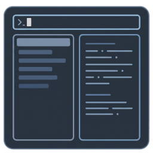
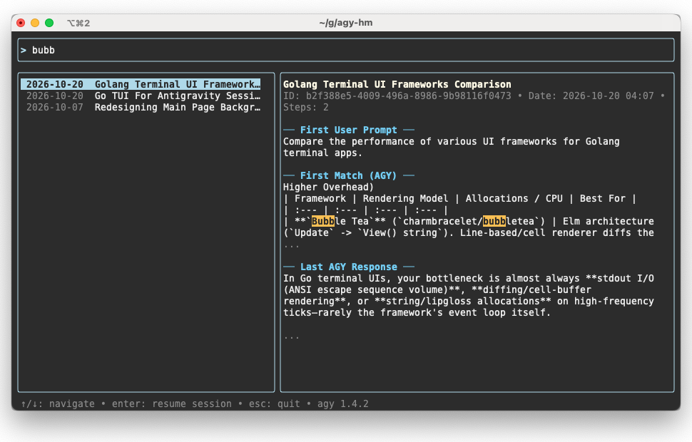
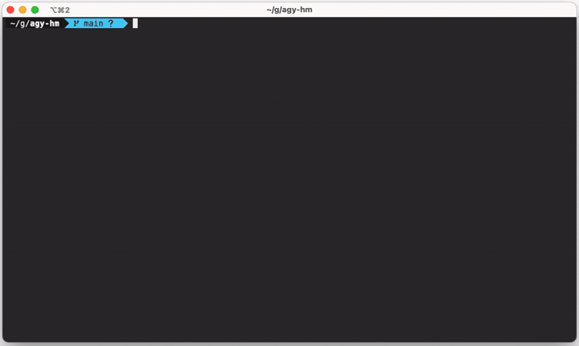

<p style="text-align:center;" align="center">
  
</p>

<h2 align="center">agy-hm — History Manager for Antigravity CLI & Jetski</h2>

<p align="center">
  <strong>Interactive TUI for browsing, full-text searching, previewing, and instantly resuming <code>agy</code> and <code>jetski</code> conversations.</strong>
</p>

<p align="center">
  <a href="#-key-features">Key Features</a> •
  <a href="#-overview--preview">Overview & Preview</a> •
  <a href="#-tech-stack">Tech Stack</a> •
  <a href="#-installation">Installation</a> •
  <a href="#-building-from-source">Building from Source</a> •
  <a href="#-license">License</a>
</p>

---

## 🎯 Key Features

- **Instant Full-Text Search:** Filters all local conversations as you type across user prompts, planner responses, and session titles — completely in memory with zero external CLI dependencies (`grep` / `rg` not required).
- **Rich Live Preview:** Split-pane terminal layout displays the auto-generated session title, metadata, **First User Prompt**, **Last AGY Response**, and a highlighted snippet of the **First Match** when searching.
- **`agy` & `jetski` Auto-Detection:** Automatically detects `~/.gemini/jetski` (if present) or `~/.gemini/antigravity-cli`, displays the active agent version in the status bar, and launches the matching CLI binary.
- **Terminal-Native Colors & Fast Resize:** Adapts naturally to your terminal's color scheme so the interface looks crisp on any dark, light, or custom theme.
- **Single Static Binary:** Zero runtime dependencies on macOS and Linux.

---

## 📸 Overview & Preview

<p align="center">
  
</p>

<p align="center">
  
</p>

### Keyboard Shortcuts

| Key               | Action                                                       |
| :---------------- | :----------------------------------------------------------- |
| `Type any text`   | Full-text search across all session prompts and responses    |
| `↑` / `↓`         | Navigate through the sorted conversation list                |
| `Enter`           | Resume the selected session in `agy` or `jetski`             |
| `Esc` / `Ctrl+C`  | Exit `agy-hm`                                                |

---

## 🛠 Tech Stack

| Component            | Technology                                              | Description                                                       |
| :------------------- | :------------------------------------------------------ | :---------------------------------------------------------------- |
| **Language**         | [Go 1.26+][go]                                          | Fast transcript parsing and in-memory search                      |
| **TUI Framework**    | [Bubble Tea][bubbletea] + [Bubbles][bubbles]            | Elm-inspired reactive terminal user interface                     |
| **Styling & Layout** | [Lip Gloss][lipgloss]                                   | Terminal styling and responsive two-column layout                 |
| **Database Driver**  | [modernc.org/sqlite][sqlite]                            | Pure-Go, CGo-free reader for `conversation_summaries.db` titles   |

[go]: https://go.dev/
[bubbletea]: https://github.com/charmbracelet/bubbletea
[bubbles]: https://github.com/charmbracelet/bubbles
[lipgloss]: https://github.com/charmbracelet/lipgloss
[sqlite]: https://gitlab.com/cznic/sqlite

---

## 🚀 Installation

### Option 1: Download Prebuilt Binary

Download the binary for your platform from the [Releases](https://github.com/ganochenkodg/agy-hm/releases) page (or the `dist/` directory) and move it into your `$PATH`:

```bash
# Example for macOS (Apple Silicon)
chmod +x agy-hm-darwin-arm64
sudo mv agy-hm-darwin-arm64 /usr/local/bin/agy-hm
```

### Option 2: Install with Go

```bash
go install github.com/ganochenkodg/agy-hm@latest
```

### Usage

Simply run `agy-hm` in your terminal without arguments:

```bash
agy-hm
```

> **Note on `jetski` & `agy` compatibility:**
> On startup, `agy-hm` checks if `~/.gemini/jetski` exists. If found, it reads sessions from `~/.gemini/jetski` and resumes them using `jetski --conversation <id>`. Otherwise, it uses `~/.gemini/antigravity-cli` and `agy --conversation <id>`.

---

## 📦 Building from Source

Clone the repository and build static binaries (`CGO_ENABLED=0`) for macOS and Linux:

```bash
git clone https://github.com/ganochenkodg/agy-hm.git
cd agy-hm

# Build for current platform
go build -o agy-hm .

# Cross-compile release binaries for macOS and Linux
mkdir -p dist
CGO_ENABLED=0 GOOS=darwin GOARCH=amd64 go build -ldflags="-s -w" -o dist/agy-hm-darwin-amd64 .
CGO_ENABLED=0 GOOS=darwin GOARCH=arm64 go build -ldflags="-s -w" -o dist/agy-hm-darwin-arm64 .
CGO_ENABLED=0 GOOS=linux  GOARCH=amd64 go build -ldflags="-s -w" -o dist/agy-hm-linux-amd64 .
CGO_ENABLED=0 GOOS=linux  GOARCH=arm64 go build -ldflags="-s -w" -o dist/agy-hm-linux-arm64 .
```

Run tests:

```bash
go test -v ./...
```

---

## 📄 License

This project is licensed under the MIT License — see the [LICENSE](LICENSE) file for details.
